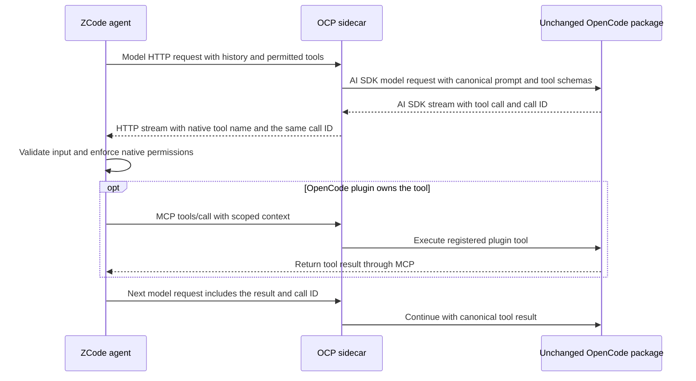

# Running OpenCode plugins from ZCode

ZCode 3.18.2 exposes enough of the agent runtime to justify testing an external OCP bridge for provider plugins. The candidate is a local HTTP model endpoint backed by OCP's existing OpenCode loader, with MCP and command hooks for the companion capabilities ZCode exposes. Loading an unchanged provider package through that bridge is a narrower compatibility claim than running arbitrary OpenCode server, TUI, or GUI plugins. The public ZCode extension API exposes model reads and telemetry. The agent's provider construction is a separate path with three built-in HTTP transports. [ZCode source release][z-release] · [Extension capabilities][z-cap] · [Provider construction][z-model] · [OCP loader](../packages/opencode-loader/README.md)

Source baseline: ZCode `fec97590`, OCP `218169b`. Current OCP describes ZCode as T0 and ships asset migration for plugin-packaged skills, commands, and manifests. ZCode's own OpenCode import also expects a marketplace manifest, regardless of which directory it scans. Any experimental runtime compatibility would have a separate capability report from that migration path. [Current OCP support](hosts/opencode-clones.md#5-zcode--not-a-load-target) · [Asset migration](guides/zcode-import-and-migrate.md) · [ZCode import contract][z-import]

## Verified host surfaces

| ZCode surface | What OCP could use |
|---|---|
| Personal model provider | Configure a model ID, a base URL and an API contract. The model factory selects Anthropic Messages, OpenAI Chat Completions, or OpenAI Responses and drives AI SDK `streamText`. ZCode has a real-adapter fixture that talks to a loopback server and checks a streamed tool request followed by a continuation with its result. [Provider schema][z-provider] · [Factory][z-model] · [Loopback fixture][z-fake] · [Tool round-trip test][z-round] |
| Marketplace MCP | Publish plugin-owned tool schemas and handlers through the bridge's MCP server. ZCode loads `.mcp.json` or manifest `mcpServers`, namespaces the server, prefixes model-visible tool names, and puts calls through its MCP permission pipeline. MCP requests can carry session, turn and workspace context in `_meta`. [Plugin MCP loader][z-mcp] · [Names and schemas][z-desc] · [Permission and dispatch][z-mcp-perm] · [Request context][z-mcp-meta] |
| Process or command hooks | Relay a supported event to the sidecar and return the decisions ZCode understands. `PreToolUse` can modify already-valid inputs. `PostToolUse` can provide context but has no result replacement. The hook event list contains neither a compaction hook nor a shell-environment hook. [Hook types and events][z-hooks] · [Hook stdin and effects][z-hook-io] · [Validation order][z-validation] |
| Desktop extension | An OCP wrapper could use `extension.main` and `activate(ctx)` for commands or a settings view. The Desktop extension process is separate from the agent. Its RPC serializes values and the capability table gives models `list` and `onDidGenerate`. This API provides no model registration, per-request model callback, or native tool-executor registration. [Process topology and RPC][z-process] · [Activation][z-activation] · [Context][z-ctx] · [Capability table][z-cap] |

## Proposed external bridge

1. **Load the original package in an OCP-owned process.** Reuse `opencode-loader` for install-entry resolution, the `createXxx()` factory, Classic `auth` and `config`, and the existing auth/catalog helpers. Install applicable neutral path and skills contracts before import. Use an explicit package specifier and scoped, durable auth storage. Handle upstream login and credential refresh in OCP. Give ZCode a separate local bridge credential and configure its models through its Personal provider surface. Add a loader path for tool-only Classic packages before claiming them. `inspectOpenCodePluginModule` currently resolves a provider factory unconditionally. [Loader implementation](../packages/opencode-loader/src/load.ts#L39-L137) · [Auth context](../packages/opencode-loader/src/host-stub.ts#L71-L134) · [Scoped skills](../packages/opencode-loader/README.md) · [Personal provider configuration][z-personal]
2. **Try Anthropic Messages first.** It gives the experiment explicit content blocks for tool calls and results, and ZCode's fixture already exercises the tool loop on this route. Convert each request to AI SDK V3 and encode text, reasoning, tool calls, finish, usage, and errors in the return stream. Support generation and streaming, preserve the host-visible call ID through replay, and verify images and provider metadata separately. Forward an HTTP disconnect to the current model request. Measure what happens when the user stops during tool execution, when there may be no model HTTP request to cancel. [ZCode wire fixture][z-round] · [Stream request options][z-stream] · [Streaming call assembly][z-assembly] · [Existing OCP continuation fixture](../test/pi-bridge-tool-loop.test.ts#L64-L131)
3. **Bind state to the host session and workspace.** Map ZCode's `x-session-id` to the canonical `x-opencode-session-id` within an authenticated environment/workspace binding. Use `x-zcode-query-source` and the session type to separate main chat and subagents from titles, compaction, and other helper requests. ZCode normalizes prefixes on the HTTP session ID. Verify correlation with the raw session IDs in MCP and hooks, including concurrent workspaces and subagents. Obtain workspace identity through authorized hook/MCP context or explicit endpoint configuration. A session header correlates requests and a bridge credential authorizes them. [ZCode request attribution][z-headers] · [Header wire test][z-headers-test] · [MCP request context][z-mcp-meta] · [OCP affinity convention](../test/pi-bridge-tool-loop.test.ts#L64-L82)
4. **Translate the live tool catalog in both directions.** Build OpenCode-facing schemas from the tools on each actual request. Keep the established catalog order and preserve empty catalogs for lifecycle calls. Map canonical calls to native names and complete native arguments before ZCode validates them. Map names, outputs, errors, and call IDs back on replay. Treat `Read`, `Agent`, `AskUserQuestion`, and `ExitPlanMode` as distinct contracts to prove, including permission denial and plan approval. Verify when plugin MCP tools are advertised, because ZCode marks them deferrable and supports `alwaysLoad`. Leave authorization and execution of native tools with ZCode. [OCP vocabulary](tool-vocabulary.md#current-tool-vocabulary) · [Catalog order](../packages/opencode-loader/README.md) · [Validation order][z-validation] · [MCP visibility][z-mcp-perm] · [Question schema][z-question] · [Plan schema][z-plan]

## Compatibility boundaries

- **Classic provider plugins** are the initial candidate. Test auth and model discovery, model calls and tool continuation, then the model, tool, and lifecycle hooks each plugin actually uses. Route applicable Classic hooks from the request or native hook events. Hooks outside those surfaces need an explicit unsupported-capability error. The shared `PluginInput` currently implements auth and supplies loud stubs for unsupported SDK methods. [Loader](../packages/opencode-loader/src/load.ts#L39-L137) · [Host input stub](../packages/opencode-loader/src/host-stub.ts#L71-L133) · [Hook effects][z-hook-io]
- **OpenCode 1.18 Promise v2** needs the OCP host kit and actual invocation of `ctx.aisdk.sdk` and `ctx.aisdk.language` from the sidecar's model-resolution path. Preserve the kit's explicit errors for unsupported domains. **OpenCode 2.x** uses another contract: server modules export an `id` with `setup` or `effect`, with a separate host context. A Promise v2 fixture cannot establish OpenCode 2.x support. [Promise v2 host kit](../packages/host-promise-v2/src/index.ts#L64-L115) · [OpenCode 2 server loader][oc2-module]
- **Runtime-wide hooks, arbitrary SDK calls, and UI plugins** remain outside the source-backed candidate. HTTP sees calls routed to the bridge. Command hooks expose a fixed event list and effect set. MCP tool approval and the extension API's scoped session actions do not provide the same semantics as an arbitrary OpenCode plugin permission or session method. Full unchanged-plugin compatibility would require public equivalents for the missing capabilities. [ZCode hook contract][z-hooks] · [Hook effects][z-hook-io] · [Extension capabilities][z-cap] · [OpenCode 2 plugin entrypoints][oc2-module]

## Acceptance on stock ZCode

1. Record the installed executable, version and resolved plugin entry. In an isolated profile, point a Personal provider to a loopback OCP endpoint and load the existing Acme fixture unchanged. Prove catalog selection, streaming, non-streaming, auth refresh, one native read and its replay, one plugin-owned MCP tool, denial without a side effect, and a stable tool-call ID through the next request. [Generic Acme fixture](../test/fixtures/pi-bridge-acme-provider.ts) · [ZCode loopback test][z-round]
2. Repeat with two simultaneous workspaces, a subagent and a title or compaction request. Verify permission prompts, stop during streaming and between requests, restart behavior, errors and retries, using the actual UI or CLI transcript, bridge wire capture and observed effects. Treat each uncovered host capability as a limit of the bridge. [ZCode request attribution][z-headers] · [OCP acceptance rules](../AGENTS.md#non-negotiable-vendor-boundary)
3. Run a published Cursor package unchanged against a controlled backend, then run an authorized live smoke. Exercise native question and plan flows, edit denial, tool continuation, session affinity, and the image and shell paths before advertising those capabilities. Capture the permitted catalog, emitted native arguments, execution outcome, and replay for each case. [Cursor host acceptance](https://github.com/oakimov/cursor-opencode-provider/blob/main/docs/host-compat-acceptance.md) · [OCP validation rules](../AGENTS.md#non-negotiable-ocp--consumer-provider-boundary)

In this investigation, 121 existing OCP tests passed across the matrix, migration, loader/auth, and Pi/DSH translation fixtures. Stock ZCode runtime behavior is unverified. The source checkout had no installed workspace dependencies, and its pnpm lint and typecheck commands stopped at dependency validation.

[z-release]: https://github.com/zai-org/ZCode/tree/fec975905a2abd4c07e35c40d51fa097a2258ec9
[z-import]: https://github.com/zai-org/ZCode/blob/fec97590/docs/external-agent-plugins-import.md#L9-L37
[z-provider]: https://github.com/zai-org/ZCode/blob/fec97590/packages/provider/src/config/provider-data-schema.ts#L4-L8
[z-personal]: https://github.com/zai-org/ZCode/blob/fec97590/docs/working-memory/provider-refactor/design/registry/provider-and-model-configuration-overview.md#L153-L184
[z-model]: https://github.com/zai-org/ZCode/blob/fec97590/apps/zcode-cli/packages/adapters/src/model/model-execution.ts#L294-L368
[z-fake]: https://github.com/zai-org/ZCode/blob/fec97590/apps/zcode-cli/packages/bootstrap/tests/helpers/fake-provider-server.ts#L296-L339
[z-round]: https://github.com/zai-org/ZCode/blob/fec97590/apps/zcode-cli/packages/bootstrap/tests/fake-provider-server.test.ts#L145-L172
[z-mcp]: https://github.com/zai-org/ZCode/blob/fec97590/apps/zcode-cli/packages/adapters/src/plugins/mcp.ts#L28-L75
[z-desc]: https://github.com/zai-org/ZCode/blob/fec97590/apps/zcode-cli/packages/adapters/src/mcp/descriptor.ts#L10-L43
[z-mcp-perm]: https://github.com/zai-org/ZCode/blob/fec97590/apps/zcode-cli/packages/core/src/mcp/index.ts#L191-L273
[z-mcp-meta]: https://github.com/zai-org/ZCode/blob/fec97590/apps/zcode-cli/packages/adapters/src/mcp/index.ts#L2360-L2386
[z-hooks]: https://github.com/zai-org/ZCode/blob/fec97590/docs/hooks-runtime-contract.md#L7-L55
[z-hook-io]: https://github.com/zai-org/ZCode/blob/fec97590/docs/hooks-runtime-contract.md#L120-L211
[z-validation]: https://github.com/zai-org/ZCode/blob/fec97590/apps/zcode-cli/packages/core/src/tool/executor/call-runner.ts#L235-L418
[z-process]: https://github.com/zai-org/ZCode/blob/fec97590/docs/plugins/extension-host.md#L32-L89
[z-activation]: https://github.com/zai-org/ZCode/blob/fec97590/packages/desktop/src/extension-host/registry.ts#L312-L402
[z-ctx]: https://github.com/zai-org/ZCode/blob/fec97590/packages/shared/src/extension-host/context.ts#L25-L61
[z-cap]: https://github.com/zai-org/ZCode/blob/fec97590/packages/shared/src/extension-host/capabilities.ts#L93-L407
[z-stream]: https://github.com/zai-org/ZCode/blob/fec97590/apps/zcode-cli/packages/adapters/src/model/runner-options.ts#L110-L165
[z-assembly]: https://github.com/zai-org/ZCode/blob/fec97590/apps/zcode-cli/packages/adapters/src/model/streaming-tool-call-assembler.ts#L48-L116
[z-headers]: https://github.com/zai-org/ZCode/blob/fec97590/apps/zcode-cli/packages/adapters/src/model/runner-attribution.ts#L20-L65
[z-headers-test]: https://github.com/zai-org/ZCode/blob/fec97590/apps/zcode-cli/packages/adapters/tests/model-query-source-wire.test.ts#L22-L119
[z-question]: https://github.com/zai-org/ZCode/blob/fec97590/apps/zcode-cli/packages/contracts/src/tools/ask-user-question.ts#L9-L71
[z-plan]: https://github.com/zai-org/ZCode/blob/fec97590/apps/zcode-cli/packages/contracts/src/tools/plan-mode.ts#L10-L77
[oc2-module]: https://github.com/anomalyco/opencode/blob/c0ad18b402eb2827fc1ee71c171b1177b3fc02d1/packages/core/src/plugin/module.ts#L81-L185
